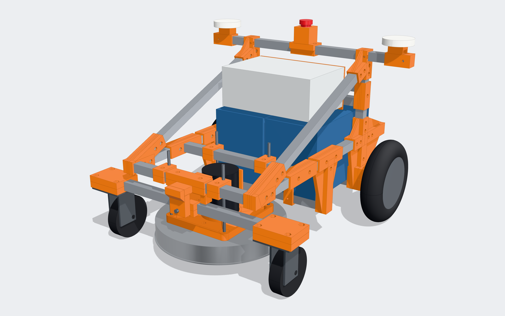
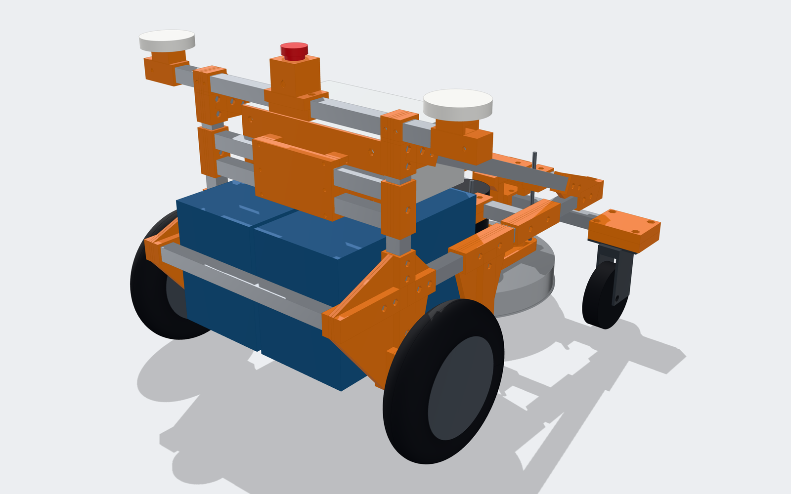
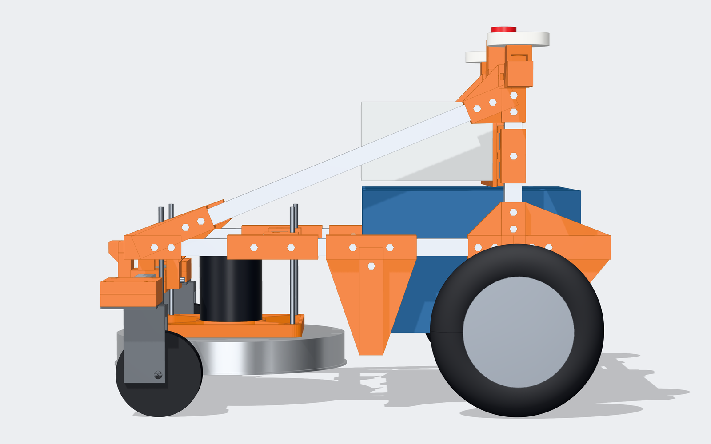
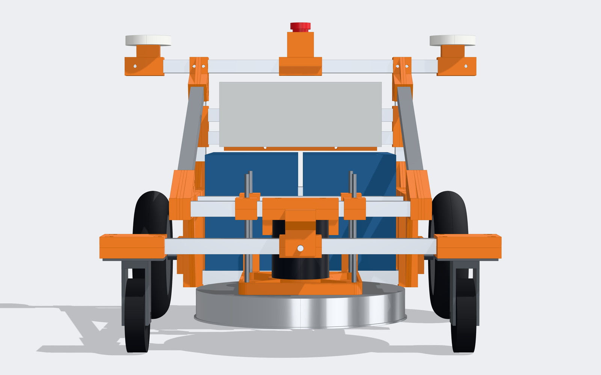
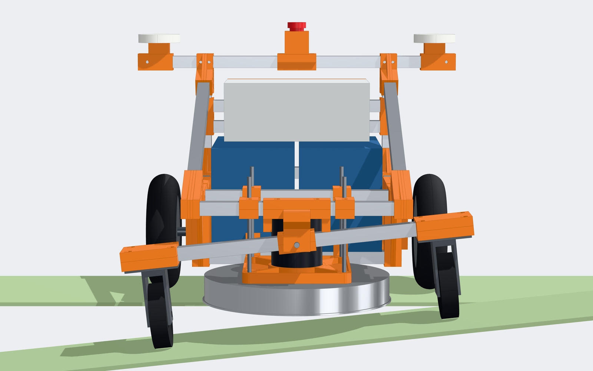
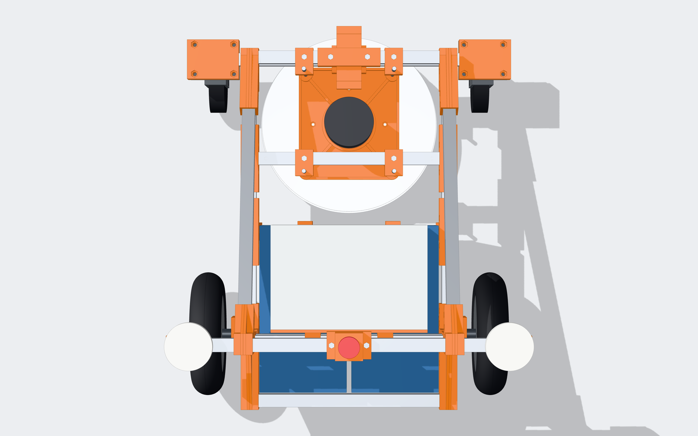
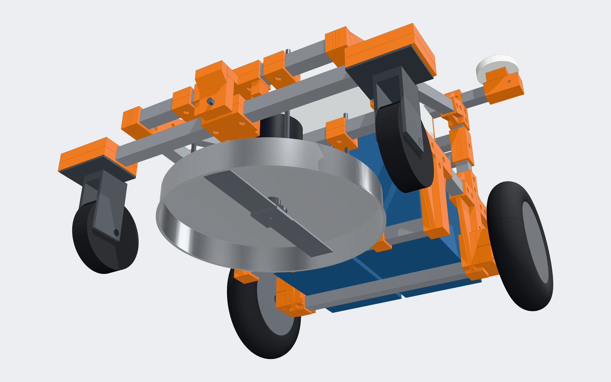
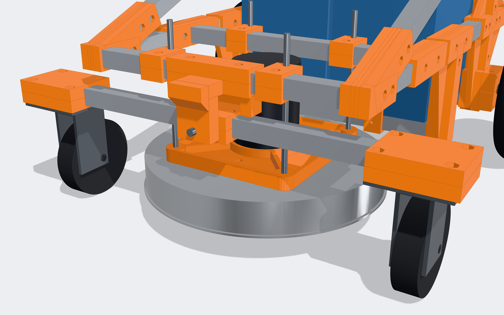
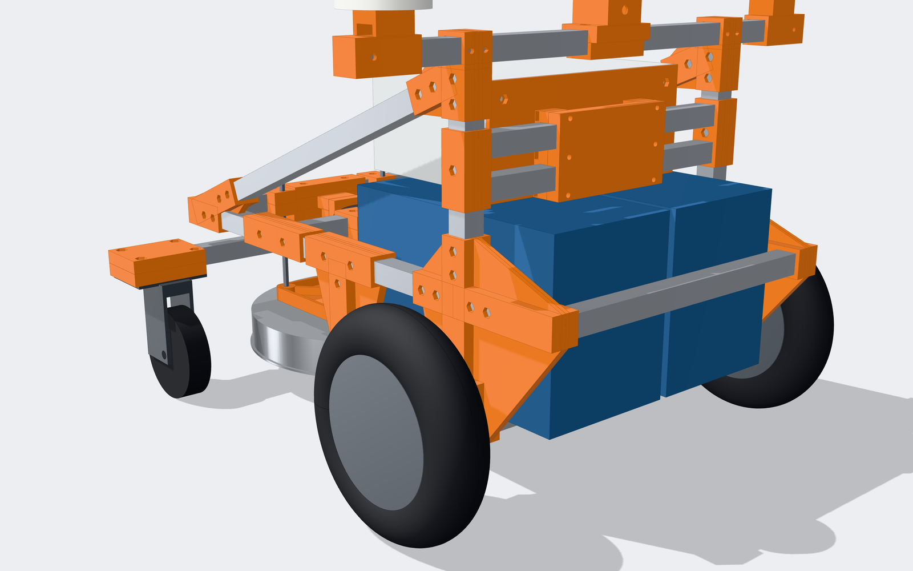
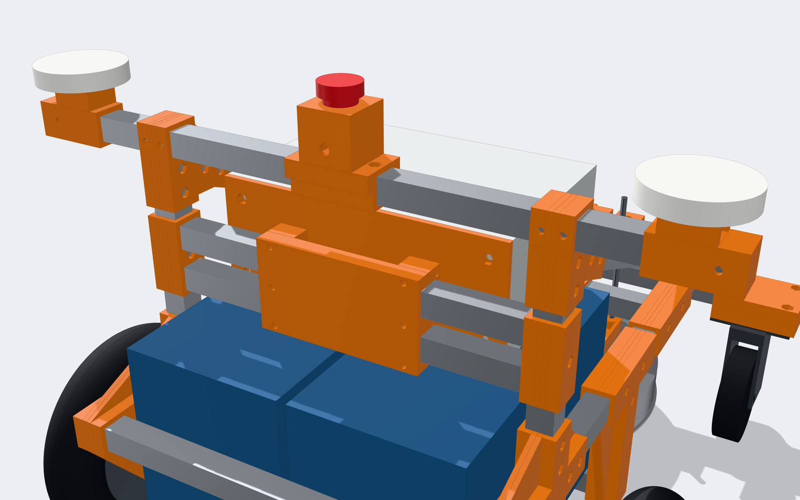

# SwardBot: Open Source Acreage Mower

SwardBot is an open-source autonomous mower for large acreage and pasture, built on ArduPilot. It aims to make an ArduPilot mower affordable and simple to build: commodity components, aluminium tube cut square, and 3D-printed joints, with no welding. See the [goals](docs/goals.md).

It's also a collection of documentation and design patterns, so anyone can build an autonomous mower to their own specifications. (Keywords: AGV, UGV, mower, ArduPilot, rover)



## The design

- **Frame:** two triangular side frames of 25.4 mm square aluminium tube from Bunnings, cut square and joined by 3D-printed clamp nodes. It takes 7.2 m of tube.
- **Drive:** two 10" BLDC hub motors at the back, fixed to the frame. It steers by driving them at different speeds.
- **Front suspension:** two 5" castors on a beam that pivots on a fore-aft pin. The beam rolls ±6°, so all four wheels stay on uneven ground.
- **Deck:** a 34 cm blade under an upturned 36 cm stainless tray, driven by a 400 W motor. The deck hangs on four threaded rods, and nuts on the rods set the cut height from 40 to 100 mm.
- **Power:** two 100 Ah LiFePO4 batteries in series, 25.2 V, sitting low between the rear wheels. The centre of gravity is only 209 mm up.
- **Electronics:** a Pixhawk running ArduPilot sits in a box above the batteries. Two UM982 GPS antennas, 600 mm apart on the top bar, give RTK position and heading. An e-stop sits between them.
- **Printed parts:** 51 prints from 29 files. Each fits a Bambu Lab H2S bed, prints without supports, and has its name engraved on it.
- **Parametric:** every dimension lives in [src/layout.ts](src/layout.ts). Change a component and the layout re-packs around it, with checks for fit, clearance and stability.

At the default dimensions it's 807 mm long, 680 mm wide and 562 mm high, and weighs about 48 kg. [Mechanical design](docs/mechanical-design.md) covers it in full.

## Views

Orange parts are printed, silver is aluminium tube, and blue are the batteries.

| | |
| --- | --- |
| <br>**Rear right.** The batteries sit low between the hub motors, held in by the bumper. The electronics box sits above them. | <br>**Side.** Each side frame is a triangle: a post over the rear axle, a level rail and a sloping leg. The deck hangs between the batteries and the castors. |
| <br>**Front.** The castors sit on the front beam, which pivots under the front cross member. | <br>**Front beam rolled 6°.** The castors follow a side slope while the drive wheels stay on level ground. |
| <br>**Top.** The deck plate and mower motor sit on the tray. The GPS antennas and e-stop are on the top bar. | <br>**Underside.** The blade turns inside the upturned stainless tray. |
| <br>**Front beam and deck.** These are the pivot saddle and hanger, and the castor pads. The deck plate hangs on threaded rods through clamp blocks. | <br>**Rear corner.** The rear node clamps the post, rails and bumper, and holds the hub motor's axle. |
| <br>**Top bar.** The GPS antenna mounts sit on its ends, and the e-stop in its middle. The electronics box bolts to a backplate clamped to two rails. | |

`make views` re-renders these views from the CAD.

## Documentation

- [Goals](docs/goals.md): what SwardBot sets out to be.
- [Design](docs/design.md): the chosen components and power system.
- [Mechanical design](docs/mechanical-design.md): the chassis, print list, fasteners, cut list, holes to drill, assembly and open items.
- [Mower deck](docs/mower-deck.md), [Blades](docs/blades.md) and [RPM calculations](docs/rpm-calculations.md): the deck, blade and tip speed.
- [Development](docs/development.md): the CAD toolchain and make targets.
- [Simplifications](docs/simplifications.md) and [To do](docs/todo.md): what's left, and ways to make it simpler.
- [References](docs/references.md): related projects.

## Building the CAD

The chassis is modelled in [brepjs](https://github.com/andymai/brepjs), code-first CAD in TypeScript. It needs Node 24+ and ImageMagick.

```bash
make install   # the toolchain
make layout    # the layout, mass budget, checks and cut list
make verify    # check the layout and every part
make export    # STL and STEP of every printed part, into out/
make views     # the renders above
```

## Project status

The chassis is designed and every printed part builds and verifies, but nothing is built yet.

- **To confirm:** several bought-in parts aren't confirmed yet, so their sizes are guesses for now (see [Open items](docs/mechanical-design.md#open-items)):
  - the hub motors;
  - the mower motor;
  - the castors;
  - the electronics box.
- **Next:** test prints of a node, an end cap, a battery stop and the drill jig, tried on offcuts of real tube.

What's left before a first run is in [To do](docs/todo.md).

## Contributing

SwardBot is open source and welcomes contributions from developers, makers and enthusiasts. If you have an issue or a suggestion, open a GitHub issue or a pull request.
