# Mechanical design

[← Design](design.md)

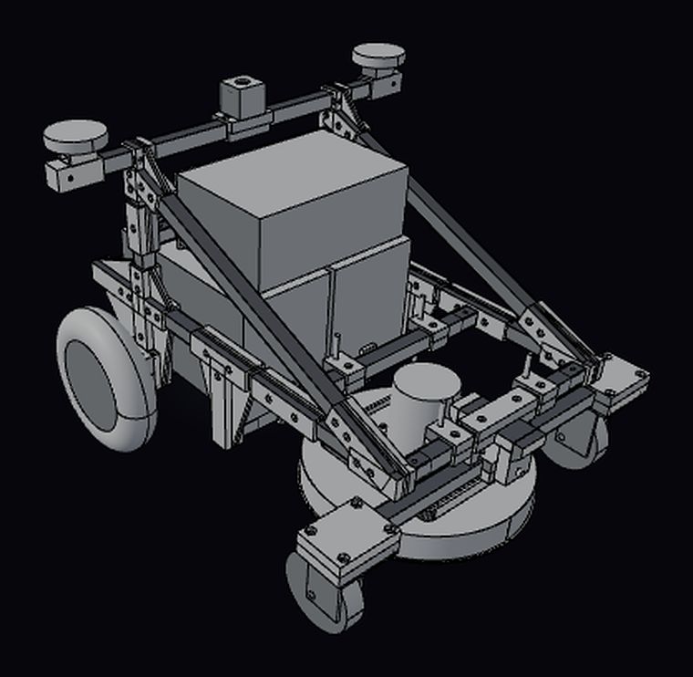

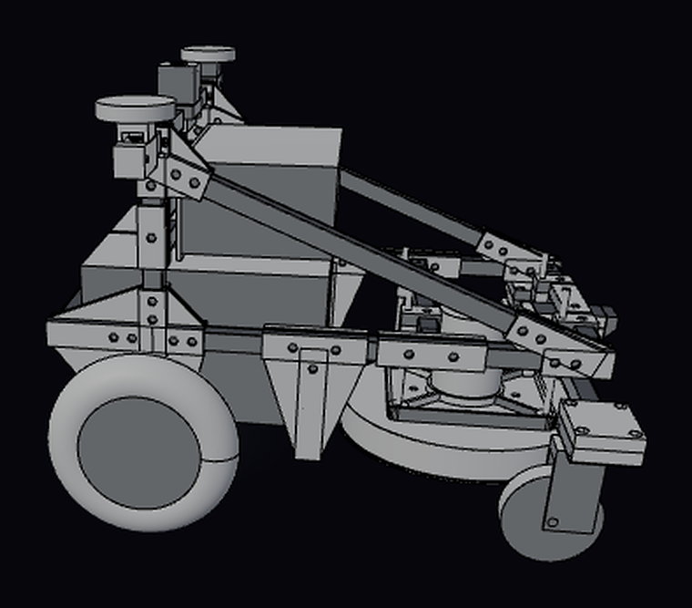

The chassis is a frame of square aluminium tube, cut square and joined by 3D-printed nodes. Two driven hub-motor wheels at the back are fixed to the frame. Two castors at the front sit on a beam that pivots side to side, so all four wheels stay on uneven ground. The batteries sit low between the rear wheels. The mower deck hangs from the frame on four threaded rods, between the batteries and the castors. The electronics box sits above the batteries, and the GPS antennas and e-stop sit on the top bar.

Everything is parametric. [src/layout.ts](../src/layout.ts) holds every dimension and works out the rest: where each component sits, each tube's centreline and cut length, the mass budget, and the checks the layout has to pass. The printed parts and the holes to drill in the tubes are worked out from the layout. Change a component's size and the machine re-packs around it. `make layout` prints the result. See [Development](development.md).

**Status:**

- **Done:** the whole chassis is designed and verified, and it renders as an assembly. That covers:
  - the frame and its nodes;
  - the drive wheels' axle clamps and the front beam;
  - the battery cradle and the deck, with its machined blade adapter;
  - the electronics mounting, the GPS and e-stop mounts, and the drill jig.
- **Guessed:** several bought-in parts aren't chosen, so their sizes are assumed or guessed (see [Open items](#open-items)).
- **To do:** what's left before a first run is in [To do](todo.md), and ways to make the build simpler are in [Simplifications](simplifications.md).

## Layout

Coordinates throughout: X forward from the rear axle, Y to the left, Z up from the ground, in millimetres.

The layout packs itself from the back:

1. **Batteries** sit side by side across the frame, centred a little ahead of the rear axle, as low as the axles allow.
2. **Side frames** sit just outside the battery cradle, with room for the nodes' walls.
3. **Drive wheels** sit as far out as their axles reach through the rear nodes.
4. **The deck** sits just ahead of the battery cradle.
5. **The castors** sit just far enough ahead of the deck to swing clear of it.

At the defaults that gives:

| | |
| --- | --- |
| Overall | 807 long × 680 wide × 562 high |
| Wheelbase, axle to castor swivels | 564 |
| Track, drive wheels / castors | 584 / 550 |
| Side frames, clear between | 364 |
| Deck centre ahead of the axle | 435 |
| Ground clearance under the battery cradle | 89 |
| Front pivot height | 183 |
| Mass | 48 kg |

## Frame

Each side frame is a right triangle seen from the side:

- **Post:** upright over the rear axle, from just above the axle to the top bar. Below it the rear node is solid, round the axle.
- **Rail:** level at 245 mm, above the deck and the front beam's roll. It runs in two lengths, rear and front, either side of the post.
- **Leg:** slopes down from near the top of the post to the front end of the rail.

Cross members tie the two sides together:

- the **top bar**, across the tops of the posts;
- the **front cross member**, at the front corners, which carries the front beam's pivot and the deck's front rods;
- the **bumper**, at the back, which also holds the batteries in;
- the battery cradle's two **floor tubes**;
- the **deck beam**, which carries the deck's rear rods;
- two **electronics rails** between the posts.

Every one of them ends on a spigot on a node (see [Nodes](#nodes)), except the top bar, which runs through the apex nodes.

### Tube

The default is 25.4 × 25.4 × 1.2 mm aluminium square tube, sold by Bunnings in 3 m lengths. The section is a parameter, so 30 × 30 × 1.5 or other square tube is a change of numbers. That tube is about 1.6 times stiffer in bending than 2020 extrusion, and cheaper. The frame takes about 7.2 m, from three 3 m lengths.

Every tube is cut square. All the angles are in the printed nodes, so a different layout means reprinting nodes, not re-cutting angles. Each tube's length is set so its square end butts against the tube it meets; at a shallow angle the end stops further back, and the node fills the wedge.

## Nodes

Every joint in the side frames is a printed node: two halves split on the side frame's plane through the tubes' centrelines.

**The triangle's corners:**

- **Rear node,** over the axle (213 × 229 mm). It holds:
  - the post's foot, the whole rear rail and the front rail's end;
  - the axle, in a solid boss below the post, where the axle clamp bolts on;
  - spigots for the bumper and the cradle's rear floor tube.
- **Apex node,** at the top of the post (93 × 88 mm). It holds the post's top and the leg's top, and the top bar runs through it.
- **Front node,** at the front of the rail (135 × 80 mm). It holds the front rail's end and the leg's foot, plus a spigot for the front cross member. The rail stops just behind the spigot, so its end bolts sit at the standard distances.

**Along the tubes, carrying cross members:**

- **Cradle node,** on the front rail over the battery cradle's front floor tube (135 × 179 mm). It encloses the cradle hanger, which carries the floor tube up from the rail, and has a spigot for the floor tube's end.
- **Deck node,** on the front rail (135 × 36 mm). It has a spigot for the deck beam.
- **Box node,** on the post between the rear and apex nodes (36 × 81 mm). It has spigots for the two electronics rails.

| Rear node, inner half | Apex node | Front node, inner half |
| --- | --- | --- |
| 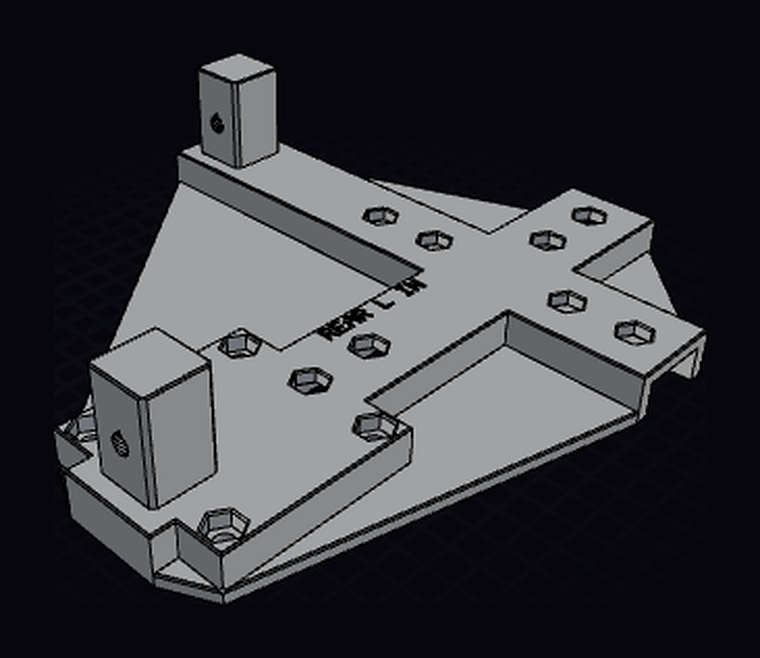 | 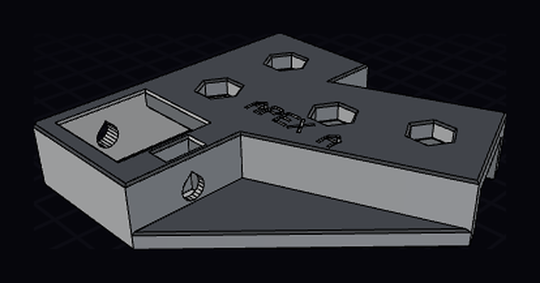 | 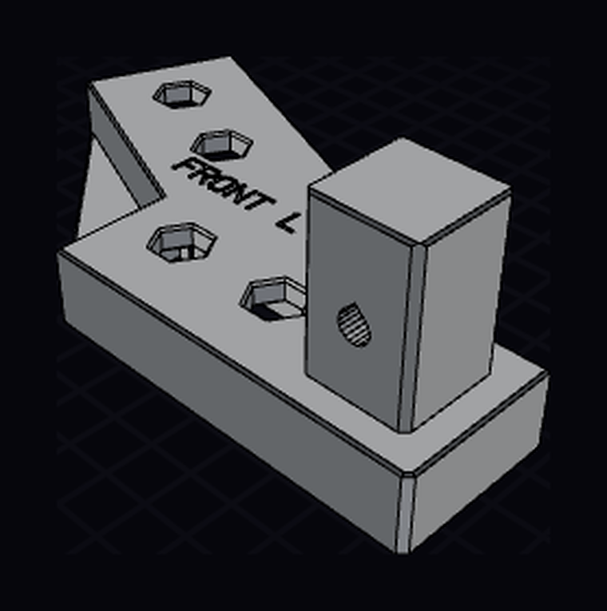 |

| Cradle node, inner half | Deck node, inner half | Box node, inner half |
| --- | --- | --- |
| 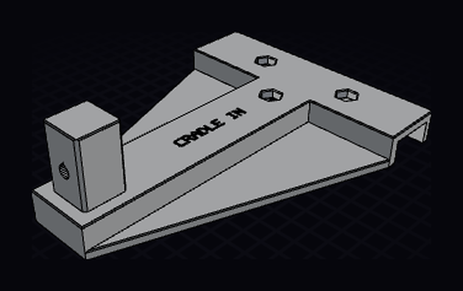 | 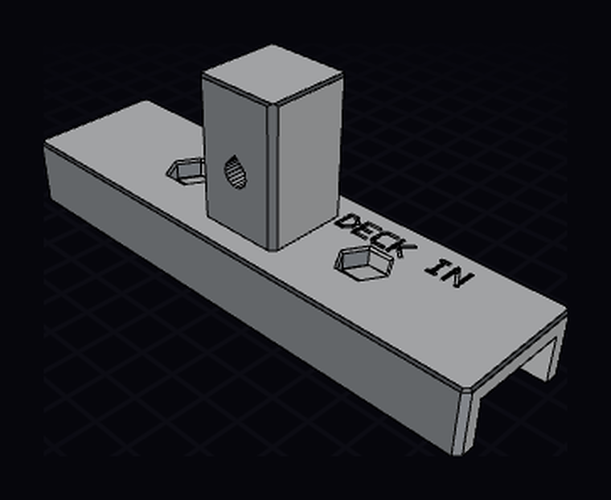 | 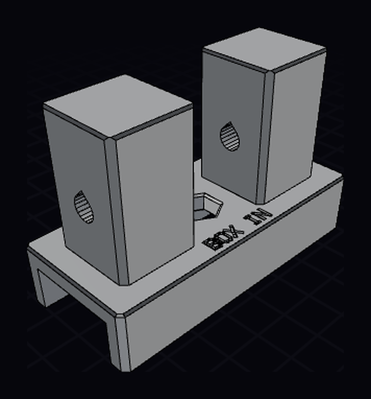 |

### How they work

- **Channels:** each tube lies in a channel in both halves.
- **Bolts:** M6 bolts pass through both halves and the tube between them, with their nuts and heads sunk into the halves' outer faces.
  - **Tube ends:** where a tube ends in a node, its two bolts sit 15 and 40 mm from its end, every time, so one drill jig drills every tube end.
  - **Light nodes:** the cradle, deck and box nodes clamp a tube running through them, carry little, and take one bolt in each arm. Those holes are drilled through the node itself.
- **No crushing:** the channels are 0.2 mm shallower than half the tube (`clampSqueeze`), so the halves grip the tube and then meet face to face. Tightening the bolts can't crush the tube's 1.2 mm wall.
- **Web:** between the tubes, the halves meet in a 10 mm web on the tubes' centreline plane, which carries the loads between them in line.
- **Wedges:** where a tube ends against another, its arm of the node starts back at the junction, so the wedge its end bears against is solid.
- **Cross members:** a cross member that ends at a node slides over a spigot standing off the inner half, which plugs the tube end. One bolt passes vertically through the tube and the spigot. The spigot's corners are chamfered, because the tube's bore has rounded corners that a square spigot would jam in.
- **Top bar:** it runs through a tunnel in both apex halves. Each half pins it with a bolt along the bar's front-to-back axis, into a nut dropped into a slot in the tunnel's front wall.

Splitting the nodes this way means no tube has to slide into a closed socket, so a closed triangle can still go together. It also means the posts, rails and top bar can run through a node rather than end in it.

The cradle, deck and box nodes are the same fore and aft, so their left and right halves are the same parts. The corner nodes are not, so the right side's are mirror images of the left's; each apex half serves two places.

## Drive wheels

The two 10" hub motors are fixed to the frame, with no suspension. Each motor's axle (assumed 20 mm, with flats) comes out of one side only.

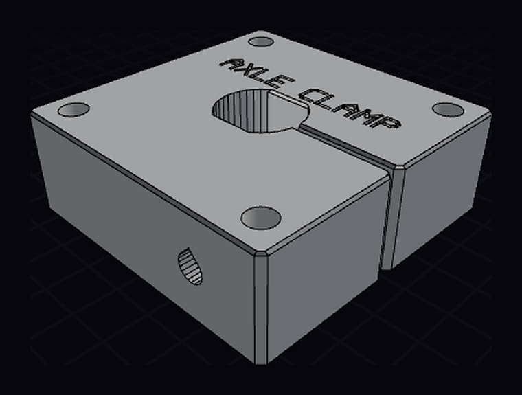

- **Through the node:** the axle runs through the axle clamp and the rear node's outer half, and ends blind in the inner half.
- **Solid boss:** the post stops just above the axle: a 20 mm hole would leave almost nothing of a 25.4 mm tube's walls. Below the post the rear node is a solid boss, full thickness in both halves, so the axle bears on about 33 mm of plastic.
- **Axle clamp:** a block round the axle between the rear node and the wheel (print 2).
  - **Flats:** its bore is flatted to fit the axle's flats, which stop the motor's stator turning, and it's slit through to the front. An M6 × 80 bolt across the slit pinches it shut on the flats, taking up any play.
  - **Fixing:** four M6 × 60 bolts through the clamp and the rear node's boss hold it to the frame. They run clear of the post, into nuts sunk in the inner half.

How far the axle reaches into the frame sets how far out the wheel sits. The axle's length and flats are guesses until the motor is chosen; the layout checks that the gap to the wheel leaves room for the clamp, and that the clamp grips at least a diameter of the axle.

## Front beam

One beam across the front carries a castor at each end. It pivots on a fore-aft pin through its middle, under the front cross member. With the front free to roll, the machine always stands on three points (the two drive wheels and the pivot), so both drive wheels stay loaded on uneven ground. That matters because a machine that steers by driving its wheels at different speeds can't steer with a wheel in the air.

Stops limit the roll to ±6° (`rollLimit`), about ±29 mm at each castor. Past that the machine stands on all four wheels, which is what keeps it stable on a side slope.

| Pivot saddle | Pivot hanger | Pivot hanger cap | Castor pad |
| --- | --- | --- | --- |
| 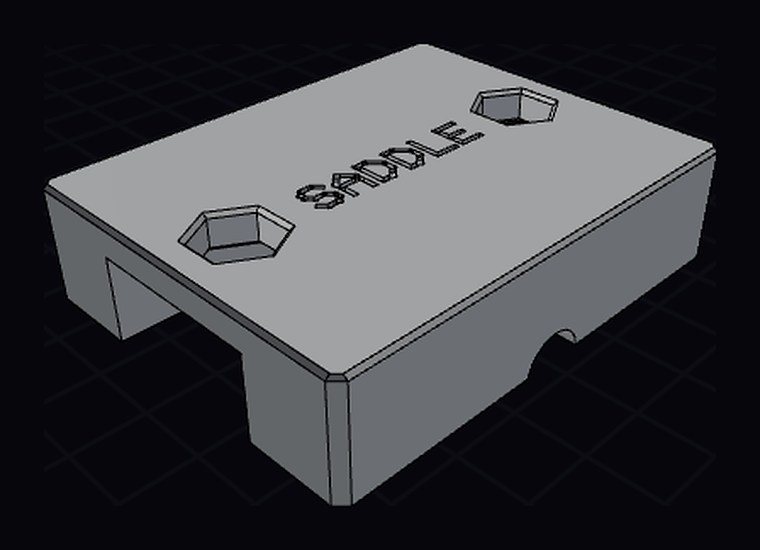 | 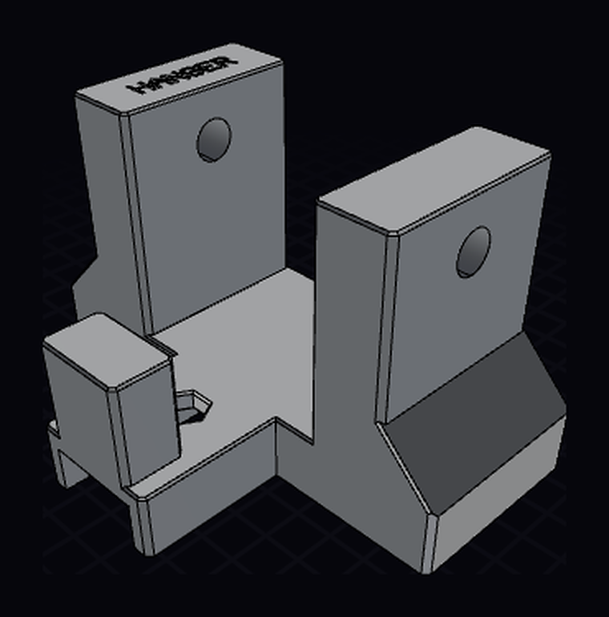 | 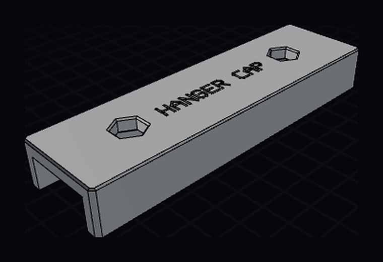 | 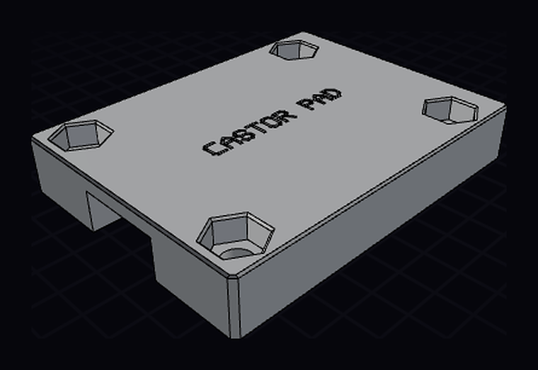 |

The front beam's parts are each a two-half clamp like the nodes, with halves that meet before the bolts can crush the tube:

- **Pivot saddle:** clamps on the beam's middle, bolted through it. Between its halves it also clamps the pivot pin, an M10 bolt running fore-aft through the beam. Its cheeks reach 15 mm fore and aft of the beam, so the pin is gripped along 55 mm rather than by the beam's thin walls.
- **Pivot hanger** (lower half) and **pivot hanger cap** (upper half): clamp on the front cross member's middle, bolted through it.
  - **Ears:** the hanger's two ears, ahead of and behind the saddle, are what the pin turns in. They're 20 mm thick fore-aft: a castor catching a tussock pushes the beam back, and thin ears would bend.
  - **Pin:** M10 × 120, a washer each end and a nyloc nut. Tighten the nut until the ears just touch the saddle, then back it off a quarter turn: the saddle needs 0.5 mm of play each side (`pivotEndPlay`) to roll freely. Grease the ears' bores.
  - **Roll stops:** two pads under the hanger, 47–63 mm out from the middle. The beam's top meets them when it has rolled 6°.
- **Castor pad:** clamps on each end of the beam. The castor's plate bolts under it with four M8 bolts, which clamp the halves too, so the beam's ends need no holes. Each pad's end wall caps the beam's end and stops the beam sliding through, and the castor's plate sits flush with the pad.

At full roll the beam's ends rise toward the front nodes; that's what sets the rail at 245 mm.

## Battery cradle

The batteries stand side by side, long sides fore-aft, on two floor tubes across the frame:

- the **rear floor tube** runs between the rear nodes, just under the axles;
- the **front floor tube** runs between the cradle nodes, carried up to the rails by the cradle hangers they enclose.

The batteries' centre of gravity sits between the two floor tubes. With half the machine's mass this low, the centre of gravity is only 209 mm up.

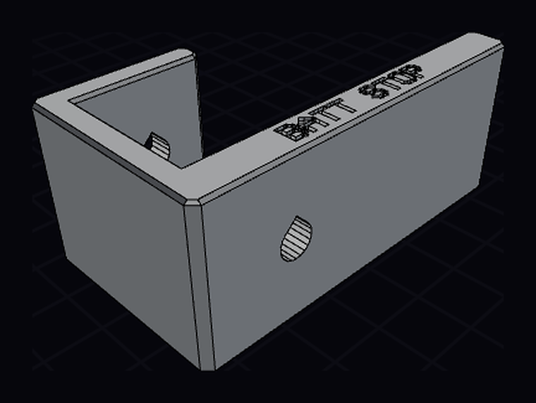

- **Battery stops:** two printed U-clips hang on the front floor tube, one under each battery. Each has a lip standing 40 mm up in front of its battery, so the batteries can't slide forward. Each bolts through the tube, snug, and its back wall stops just under the tube's top, so the battery sits on the tube itself.
- **Bumper:** at the back, it stops the batteries sliding back.
- **Straps:** two 25 mm cam straps hold the batteries down, one round the batteries and each floor tube.

To take the batteries out, undo the straps, unbolt the bumper and slide them out the back.

## Deck

The blade turns under an upturned 36 cm stainless baking tray, which keeps grass and stones in. The tray is a shroud only; it carries no load.

A paella pan would also do, in a wide range of sizes; see [Mower deck](mower-deck.md). Its sides flare, so set `trayDiameter` from the pan's base, not the rim it's sold by.

| Deck plate | Deck hanger block |
| --- | --- |
| 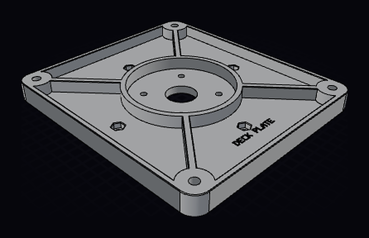 | 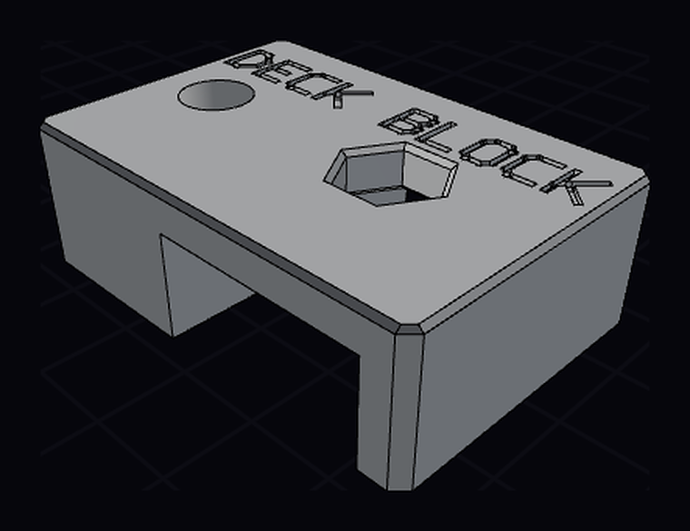 |

- **Deck plate:** a printed plate, ribbed underneath its top, that stands on the tray's top and carries the motor inside a ring.
  - **Motor and tray:** the motor's four bolts come up through the tray and the plate into the motor, so they clamp the tray to the plate too, and four more bolts hold the tray further out.
  - **Rods:** an M8 nut drops into a pocket in the plate's underside at each corner, under the tray's top. Each rod screws down into its nut, with a lock nut on top of the plate.
- **Rods:** four M8 threaded rods. They're clamped at both ends, so the deck hangs stiffly.
  - **Hanger blocks:** two-half clamps bolted through the tube that hold the rods. Two sit on the deck beam behind the motor, and two on the front cross member, just clear of the front beam.
  - **Cut height:** nuts above and below each block set it, anywhere from 40 to 100 mm. Set all four to the same height and lock them.

The motor's weight and torque go through the plate and rods straight into the frame. A different tray or blade is a parameter change, and the layout re-packs around it.

**Drilling the tray:** use the deck plate as a template, sitting where it will on the tray's top, for the motor's spigot, the motor's bolts and the tray bolts.

**Blade:**

- **Size:** 34 cm, leaving 10 mm between the blade tips and the tray wall.
- **Tip speed:** at 2900 rpm the tips run at 186 km/h, about half the 347 km/h limit in [RPM calculations](rpm-calculations.md).

### Blade adapter

Nothing printed is in the blade's load path. The adapter is two metal parts, in `src/machined/`, which `make export` writes as STEP only, never as STL.

| Blade hub | Blade washer |
| --- | --- |
| 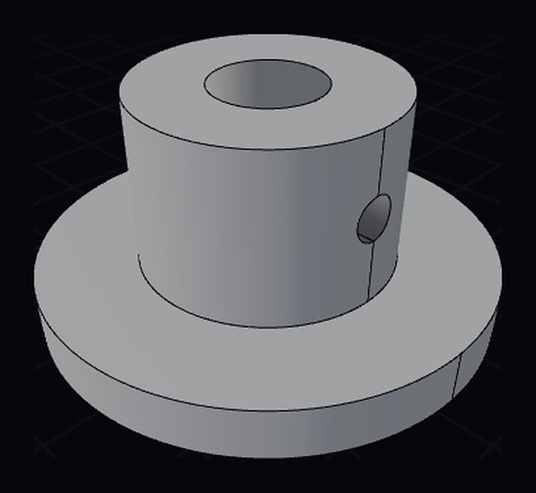 | 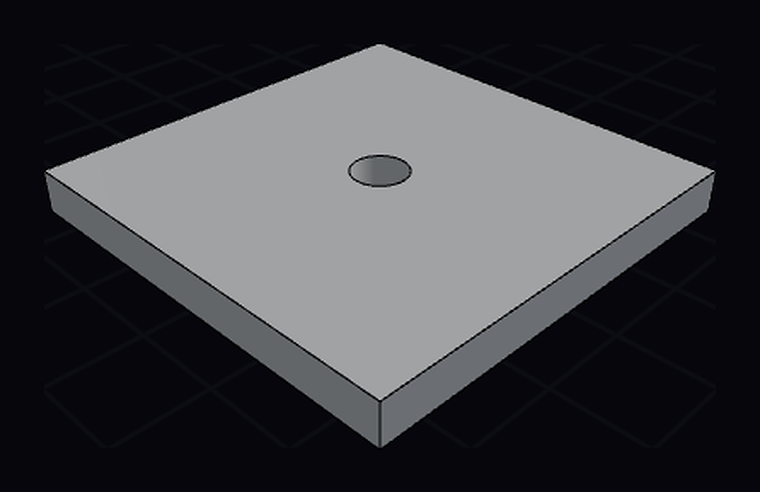 |

- **Blade hub:** turned from 50 mm aluminium (6061) or steel bar.
  - **Shape:** a 50 mm flange the blade clamps against, a 28 mm body above it, and a spigot below that locates the blade's centre hole.
  - **Bore:** 12 mm for the motor's shaft (assumed), 18.5 mm deep down to a floor. The floor is drilled for the centre bolt, and an M6 hole is tapped across the body for a set screw on the shaft's flat.
  - **Making it:** any machinist or online machining service can turn it from the STEP file.
- **Blade washer:** a 50 mm square cut from 50 × 5 mm steel flat bar and drilled through its middle. It's symmetric, so it's balanced.
- **Centre bolt:** an M6 × 25 bolt, thread-locked, goes up through the washer, the blade and the hub's floor into the thread in the shaft's end. It clamps the blade between the hub's flange and the washer, and the hub onto the shaft's end.

The blade is driven by friction, so on a rock it slips rather than breaking something. The hub sits 3 mm under the tray's top, and the adapter's heights all move with the deck, so its checks hold at every cut height.

A possible later variant has the deck ride on the front roll beam, so it rolls with the castors and they act as gauge wheels.

## Top

| Electronics backplate | Rail cap | Antenna mount | E-stop housing |
| --- | --- | --- | --- |
| 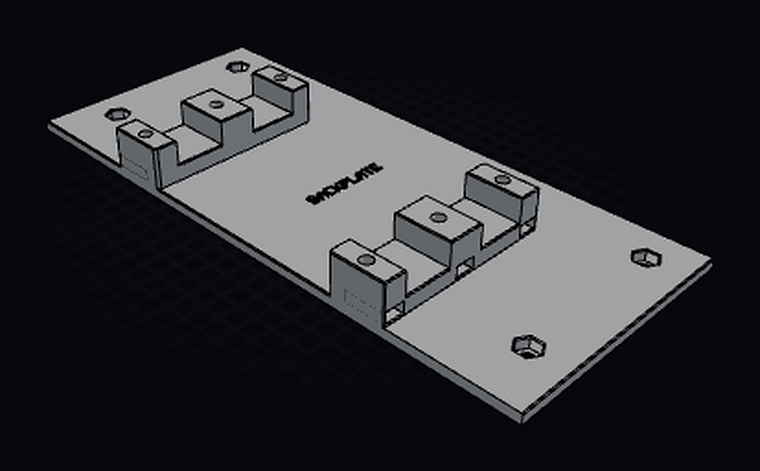 | 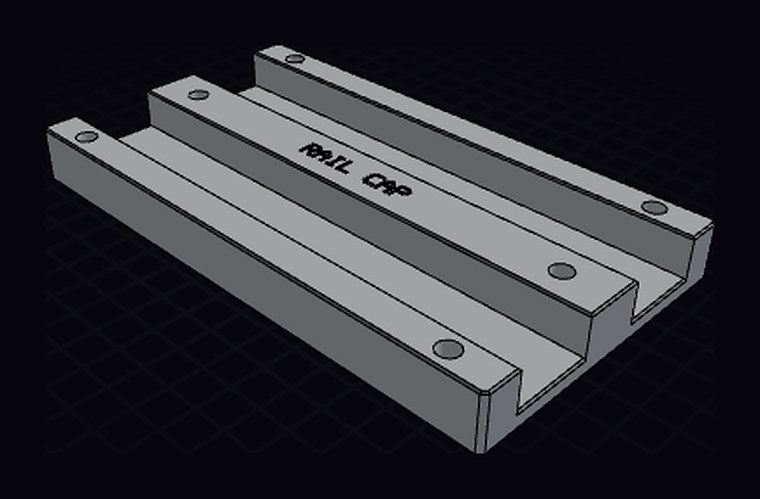 | 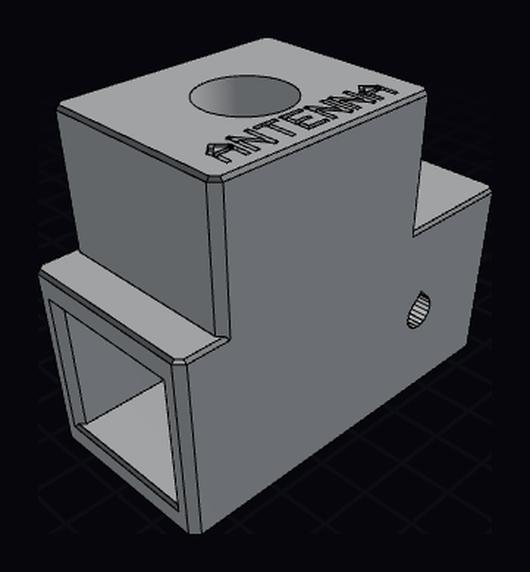 | 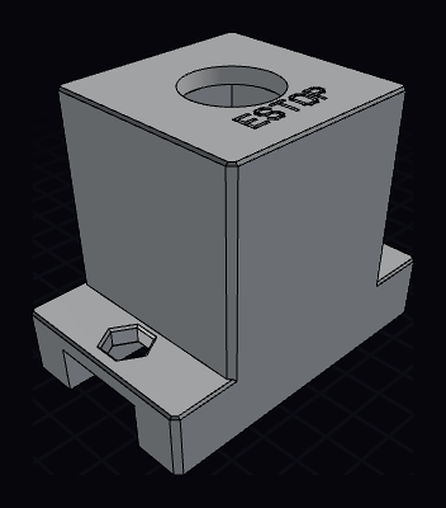 |

- **Electronics box:** sits above the batteries, between the side frames. It holds the flight controller, ESCs, contactor and wiring.
  - **Rails:** the box's back screws to the electronics backplate, which clamps to the two electronics rails between the posts. The rail cap behind clamps them with six M6 bolts into nuts slid into slots in the backplate's clamps.
  - **Standoff:** the backplate stands 8 mm off the rails, so the box screws' nuts, sunk into its back, clear them. The battery straps and wiring pass behind it.
  - **Box holes:** the backplate assumes the box's mounting holes are 260 × 80 mm apart. For another box, change `electronicsHoleSpacingY` and `electronicsHoleSpacingZ`, or drill the backplate to suit.
- **GPS antennas:** the UM982's two antennas sit 600 mm apart (`gpsBaseline`) on antenna mounts on the top bar's ends, clear of the metal below.
  - **Socket:** each mount is a socket over the bar's end, pinned through it with an M6 bolt, with a pedestal on top.
  - **Bolt:** a 5/8"-11 bolt, the survey antenna thread, slides head first into a slot under the pedestal, its shank standing up through the top, and the antenna screws on to it. For a magnetic antenna, glue a steel washer on top instead.
- **E-stop:** a 22 mm mushroom-head e-stop button mounts in the e-stop housing, a box on a clamp round the top bar's middle. Its contact block sits inside, and the cable leaves through the back.
- **Carry handle:** the top bar doubles as one.

## Balance and stability

The layout keeps a mass budget of every component and works out the centre of gravity, the weight on the castors, and the static tip angles. Those are the angles of slope at which the machine would tip over, standing still.

At the defaults:

| | | Check |
| --- | --- | --- |
| Centre of gravity | 123 mm ahead of the axle, 209 mm up | |
| Weight on the castors | 11.2 kg, 23% | 15–35% |
| Tip angle, backward | 30.4° | ≥ 30° |
| Tip angle, forward | 62° | ≥ 35° |
| Tip angle, sideways, front beam free | 44° | ≥ 30° |
| Tip angle, sideways, front beam on its stops | 54° | ≥ 35° |

The backward tip angle sets how far forward the batteries go (`batteryX`). Further back gives the drive wheels more grip, but the machine is more likely to tip back on a climb. It's only just over its limit at the defaults: if the electronics or printed parts come out heavier, move the batteries forward.

The sideways angles are worked out in plan, ignoring the height of the front pivot, so they read slightly high.

## Making it

### Print list

Every part fits a Bambu Lab H2S bed (340 × 320 mm) and prints as exported, with no supports. `make export` writes STL and STEP for each into `out/`.

**Settings:**

- **Material:** ASA, or PETG-CF, for outdoor use and UV.
- **Walls and infill:** four walls and 40% infill or more. Use six walls for the inner node halves (their spigots stand up across the layers), the axle clamps, the castor pads and the pivot hanger.
- **Brim:** a 5 mm brim on the big flat parts in ASA (the rear and cradle nodes, the deck plate and the backplate), to keep their corners down.

**Built in for printing:**

- **Chamfers:** every hard edge has a 0.6 mm chamfer (`edgeChamfer`), and edges standing up from the bed 1.5 mm (`cornerChamfer`), from [src/finish.ts](../src/finish.ts). They take off the elephant's foot and give tubes, spigots and bolts a lead-in. Inside corners are left alone, because a chamfer there would add material that a tube's end butts against. A few edges the kernel can't blend are left sharp, and `make verify` says how many.
- **Teardrops:** horizontal bolt and cable holes are teardrops, with a pointed 45° roof, so they print without sagging. The pivot ears' bores stay round because the pin turns in them; ream them to 10 mm after printing.
- **Corbels:** the e-stop housing's roof steps in at 45°, so its bridge is 34 mm rather than 46 mm.
- **Labels:** each part's label, from [src/label.ts](../src/label.ts), is engraved 0.6 mm deep in a small built-in stroke font, so no font file is needed.
  - **Placement:** it goes on the largest clear flat face up as the part prints, as near that face's middle as it fits, along its long way.
  - **Size:** 5 mm high, smaller where room is short (down to 3 mm). Where no face up has room, it goes on the bed face, mirrored to read from below.
  - **Settings:** `labelHeight`, `labelDepth` and `labelStroke`; a `labelHeight` of 0 leaves the label off.
- **Layers in line with the loads:**
  - the battery stop prints on its side, so the batteries' push on its lip runs along the layers;
  - the pivot hanger's ears have 45° gussets at their roots, because a castor's knock bends them across their layers.

Each part has its label engraved into its face up, so it can be told apart once printed:

| File | Print | Label | What |
| --- | --- | --- | --- |
| `rear-node-left-outer`, `-left-inner`, `-right-outer`, `-right-inner` | 1 each | `REAR L OUT`, `REAR L IN`, `REAR R OUT`, `REAR R IN` | Rear nodes |
| `apex-node-a` | 2 | `APEX A` | Left apex outer, right apex inner |
| `apex-node-b` | 2 | `APEX B` | Left apex inner, right apex outer |
| `front-node-left-outer`, `-left-inner`, `-right-outer`, `-right-inner` | 1 each | `FRONT L OUT`, `FRONT L IN`, `FRONT R OUT`, `FRONT R IN` | Front nodes |
| `cradle-node-outer`, `cradle-node-inner` | 2 each | `CRADLE OUT`, `CRADLE IN` | Cradle nodes |
| `deck-node-outer`, `deck-node-inner` | 2 each | `DECK OUT`, `DECK IN` | Deck nodes |
| `box-node-outer`, `box-node-inner` | 2 each | `BOX OUT`, `BOX IN` | Box nodes |
| `pivot-saddle` | 2 | `SADDLE` | Front beam pivot saddle |
| `pivot-hanger`, `pivot-hanger-cap` | 1 each | `HANGER`, `HANGER CAP` | Front beam pivot hanger |
| `castor-pad` | 4 | `CASTOR PAD` | Castor pads |
| `battery-stop` | 2 | `BATT STOP` | Battery stops |
| `deck-hanger-block` | 8 | `DECK BLOCK` | Deck hanger blocks |
| `deck-plate` | 1 | `DECK PLATE` | Deck plate |
| `electronics-backplate`, `electronics-rail-cap` | 1 each | `BACKPLATE`, `RAIL CAP` | Electronics box mounting |
| `antenna-mount` | 2 | `ANTENNA` | GPS antenna mounts |
| `estop-housing`, `estop-clamp` | 1 each | `ESTOP`, `ESTOP CLAMP` | E-stop |
| `axle-clamp` | 2 | `AXLE CLAMP` | Axle clamps |
| `drill-jig-end` | 1 | `END JIG` | Drill jig for every tube end |

That's 51 prints for the machine from 29 files, and one jig. The blade hub and washer are machined, not printed (see [Blade adapter](#blade-adapter)).

`end-cap` (labelled `CAP`, inside the cup) is a tube end cap, with crush ribs that hold it in whatever the bore measures. Its corners are chamfered by `cornerChamfer`, so they sit inside the tube's rounded corners. At the defaults no tube end is left open, so it's there for variants that leave one, such as a top bar without antenna mounts.

### Fasteners

Everything is M6 except the castors and deck rods (M8), the pivot pin (M10) and the antennas' own 5/8" thread.

| Qty | Fastener | Where |
| --- | --- | --- |
| 54 | M6 × 30 socket cap screw, M6 nut | Through the nodes and tubes (22 a side), pivot saddle (2), pivot hanger (2), deck hanger blocks (4), e-stop (2) |
| 4 | M6 × 40 socket cap screw, M6 nut | Pinning the top bar in the apex halves |
| 6 | M6 × 40 socket cap screw, M6 nut | Electronics rail cap to backplate |
| 14 | M6 × 35 bolt, 2 washers, M6 nut | Through each cross member's end and its spigot |
| 4 | M6 × 45 bolt, 2 washers, M6 nut | Battery stops (2), antenna mount pins (2) |
| 8 | M6 × 60 socket cap screw, M6 nut | Axle clamps through the rear nodes, 4 each |
| 2 | M6 × 80 bolt, 2 washers, M6 nut | Axle clamps' pinch bolts |
| 4 | M6 × 16 button head, M6 nut | Tray to deck plate |
| 4 | M6 button head | Motor through the tray and deck plate (to suit the motor's flange) |
| 4 | M6 × 16 screw, M6 nut | Electronics box to backplate (to suit the box) |
| 1 | M6 × 25 bolt, thread locker | Blade centre bolt, into the motor's shaft |
| 1 | M6 × 8 cup-point set screw | Blade hub, on the shaft's flat |
| 8 | M8 × 40 bolt, M8 nut | Castors to their pads |
| 4 | M8 threaded rod, 205 mm, and 16 M8 nuts | Deck rods: a nut in the plate, a lock nut on it, and two at each block |
| 1 | M10 × 120 bolt, 2 washers, M10 nyloc nut | Pivot pin |
| 2 | 5/8"-11 UNC × 1" hex bolt | GPS antennas |
| 2 | 25 mm cam strap | Batteries |

### Cut list

At the defaults, all 25.4 × 25.4 × 1.2 mm square tube, cut square. `make layout` prints it for any set of parameters.

| Qty | Length | Tube |
| --- | --- | --- |
| 1 | 680.0 | Top bar |
| 1 | 650.0 | Front beam |
| 2 | 538.5 | Front rails |
| 2 | 525.0 | Legs |
| 7 | 364.0 | Bumper, front cross member, cradle floor tubes (2), deck beam, electronics rails (2) |
| 2 | 345.0 | Posts |
| 2 | 143.5 | Cradle hangers |
| 2 | 127.5 | Rear rails |

That totals 7.2 m, cut from three 3 m lengths.

### Holes to drill

These are the defaults; `make layout` prints them for any set of parameters. Distances run from the rear end of rails and legs, the foot of posts and cradle hangers, and either end of cross members. Both side frames are drilled alike.

**Every tube end: one jig.** Every tube end held in a node, on a spigot or in an antenna mount has its holes 15 and 40 mm from its end (`boltInset`, `boltPitch`). The drill jig, `drill-jig-end`, drills them all: 32 tube ends. Cross members, the top bar's ends and the cradle hangers use only its first guide.

- **Using it:** slide the jig onto the tube's end until the end meets its stop, clamp the two together, and drill through the guides with a 6.5 mm bit. The drill goes through both of the tube's walls in one pass, guided going in and coming out.
- **Mark one face first:** a tube drilled from both ends must have every hole through the same pair of faces, so keep the marked face up each time.
- **The check:** `make layout` checks every tube end's holes sit at the standard distances.

**Part way along a tube: drill through the part.** Where a node or a fitting clamps on part way along a tube, mark its place, clamp it on there, and drill through its own bolt holes:

| Tube | Through | At |
| --- | --- | --- |
| Post | Rear node, above the rail | 130.5, 155.5 |
| Post | Box node | 239.3 |
| Front rail | Cradle node | 171.9, 227.3 |
| Front rail | Deck node | 319.6, 375.0 |
| Top bar | Apex nodes | 131.5, 149.2, 530.9, 548.6 |
| Top bar | E-stop housing | 307.0, 373.0 |
| Front cross member | Deck hanger blocks | 92.0, 272.0 |
| Front cross member | Pivot hanger | 145.0, 219.0 |
| Cradle floor (front) | Battery stops | 91.0, 273.0 |
| Deck beam | Deck hanger blocks | 92.0, 272.0 |
| Front beam | Pivot saddle (bolts) | 300.0, 350.0 |
| Front beam | Pivot saddle (pin) | 325.0 |

**The pivot pin hole:** drill it 9.5 mm through the saddle's pin bore, take the saddle off, and open it out to 10.5 mm.

### Assembly

1. **Side frames:** lay each side frame's outer node halves split face up. Drop in the post, rails, leg and cradle hanger. Close the inner halves over them, then bolt through and tighten until the halves meet.
2. **Cross members:**
   - Stand the left side frame up. Slide the bumper, both cradle floor tubes, the deck beam, the front cross member and the electronics rails onto its spigots.
   - Bring the right side frame on to their other ends, and bolt through the spigots.
3. **Top:** drop a nut into each apex half's slot. Slide the top bar through both apex nodes and pin it. Fit the antenna mounts on its ends and the e-stop housing at its middle.
4. **Front beam:**
   - Clamp the pivot hanger and its cap on the front cross member.
   - Clamp the saddle on the front beam, and pin the beam into the hanger's ears.
   - Clamp the castor pads on the beam's ends, and bolt the castors under them.
5. **Drive wheels:**
   - Slide an axle clamp onto each wheel's axle, its flats on the axle's flats and its slit forward.
   - Push the axle into the rear node, and bolt the clamp through the node with four M6 × 60 bolts.
   - Tighten the pinch bolt.
6. **Batteries:** bolt the battery stops on the front floor tube. Slide the batteries in from the back, strap them down and bolt the bumper on.
7. **Deck:**
   - Clamp the hanger blocks on the deck beam and the front cross member.
   - Bolt the motor and tray to the deck plate, and screw the rods into the plate.
   - Fit the blade hub on the motor's shaft with its set screw on the flat.
   - Bolt the blade and washer up into the shaft's end with the thread-locked centre bolt.
   - Lift the deck into the blocks, and set its height with the nuts.
8. **Electronics:** clamp the backplate and rail cap on the electronics rails, and screw the box to the backplate.

## Checks

`make layout` and `make verify` fail if any check fails.

**Balance and clearances:**

- weight on the castors and the four tip angles, as above;
- ground clearance under the battery cradle;
- blade tips to the tray wall;
- deck plate clear of the front beam at the highest cut;
- deck hanger blocks inside the side frames;
- mower motor clear of the deck beam and rods;
- front deck rods clear of the castor beam, and of the castors' swing;
- castor swing clear of the drive wheels;
- front beam free to roll to its stops before it meets the front nodes;
- electronics rails clear of the batteries, and the box between the legs;
- room for the axle clamp between the rear node and the wheel;
- batteries resting on both floor tubes, with their centre between them.

**Nodes:**

- each node's bolts clear of the other tubes in it, of its spigots and of the axle;
- each node fits the printer bed;
- no two nodes on a side frame touch.

**Front beam:**

- saddle bolts clear of the pivot pin;
- roll stops clear of the saddle;
- pivot hanger clear of the deck hanger blocks;
- saddle and pivot ears clear of the deck at the highest cut, and the saddle clear of the hanger when rolled;
- castor bolts clear of the beam, and inside the pad;
- each part fits the printer bed.

**Fittings:**

- the deck hanger block's rod clear of its tube, with room for the rod's nuts;
- the deck plate's motor ring, motor bolts and tray bolts each fit;
- the backplate's nut slots and clamp bolts fit, and the box screws clear its clamps;
- the antenna mount's pedestal and bolt-head slot fit;
- each part fits the printer bed.

**Axle clamps and blade adapter:**

- the axle has flats, and the clamp grips at least a diameter of it;
- the blade hub: the shaft reaches a diameter into it, with a floor of at least 4 mm under the shaft;
- room for the set screw, a wall round the bore, and the spigot round the centre bolt.

**Drill jig:**

- every tube end's holes sit at the standard distances;
- the jig fits the printer bed.

The castors are placed so they swing clear of the deck, rather than checked.

## Parameters

Every parameter is in `defaults` in [src/layout.ts](../src/layout.ts), each with a range in `schema`. The main ones:

| Parameter | Default | Note |
| --- | --- | --- |
| `wheelDiameter`, `wheelWidth` | 254, 65 | 10" hub motor |
| `axleDiameter` | 20 | **Assumed** |
| `axleFlats`, `axleLength` | 16, 75 | **Guess** until the motor is chosen |
| `axleClampLength` | 25 | **Guess**: room for the clamp |
| `wheelMass` | 5 kg | **Guess** |
| `castorWheelDiameter`, `castorHeight`, `castorTrail` | 125, 165, 40 | 5" plate castor, typical |
| `castorTrack` | 550 | |
| `castorBolt`, `castorBoltSpacingX`, `castorBoltSpacingY` | 8, 60, 80 | **Guess**: the castor plate's holes |
| `batteryLength`, `batteryWidth`, `batteryHeight`, `batteryMass` | 330, 172, 215, 11 kg | Typical 12V 100Ah LiFePO4; to confirm |
| `batteryX` | 60 | Battery centre ahead of the axle |
| `batteryStopLip`, `batteryStopWidth` | 40, 30 | |
| `bladeDiameter` | 340 | |
| `trayDiameter`, `trayDepth` | 360, 50 | Depth to confirm |
| `cutHeightMin`, `cutHeightMax` | 40, 100 | |
| `deckRearHanger`, `deckHangerSpan` | 75, 180 | Deck beam behind the deck centre; rods across |
| `deckRod`, `deckBlockHalf` | 8, 18 | M8 rods; hanger block half-length |
| `deckPlateBase`, `deckPlateHeight`, `deckPlateBoss` | 8, 20, 14 | |
| `motorBoltCircle`, `motorBoltCount`, `motorBolt`, `motorSpigot` | 70, 4, 6, 30 | **Guess**: the motor's flange |
| `trayBoltCircle`, `trayBolt` | 150, 6 | |
| `mowerMotorDiameter`, `mowerMotorLength`, `mowerMotorMass` | 100, 130, 3.5 kg | **Guess** for a 400W motor |
| `motorShaft` | 12 | **Assumed** |
| `motorShaftLength`, `motorShaftBolt` | 30, 6 | **Guess**: out of the motor's face, and the thread in its end |
| `bladeThickness`, `bladeHole` | 3, 12 | **Guess**: the blade |
| `bladeClamp`, `hubDiameter`, `hubFlange`, `bladeWasher` | 50, 28, 6, 5 | Blade adapter |
| `electronicsLength`, `electronicsWidth`, `electronicsHeight` | 200, 300, 120 | The box; to confirm |
| `electronicsHoleSpacingY`, `electronicsHoleSpacingZ` | 260, 80 | **Guess**: the box's mounting holes, for M6 screws |
| `electronicsRailLow`, `electronicsRailSpacing` | 15, 45 | Rails above the box's bottom, and apart |
| `backplateThickness`, `backplateStandoff` | 6, 8 | |
| `gpsBaseline` | 600 | |
| `antennaBolt`, `antennaBoltHead`, `antennaBoltHeadHeight` | 15.9, 23.8, 10 | 5/8"-11 hex bolt |
| `estopHole`, `estopDepth`, `estopHousing` | 22.5, 45, 52 | 22 mm e-stop |
| `tubeSize`, `tubeWall` | 25.4, 1.2 | Bunnings square tube |
| `railHeight`, `apexHeight` | 245, 500 | |
| `rollLimit` | 6° | |
| `jointWall`, `jointArm` | 5, 55 | Node walls, and how far each node reaches along a tube |
| `boltDiameter`, `nutAcrossFlats`, `nutThickness` | 6, 10, 5 | M6, used throughout |
| `boltInset`, `boltPitch` | 15, 25 | Every tube end's holes: 15 and 40 mm from the end |
| `spigotLength` | 35 | |
| `fitTolerance`, `clampSqueeze` | 0.4, 0.4 | Raise the fit if tubes go in tight; the squeeze if they're loose once bolted |
| `pivotPin`, `pivotEarThickness`, `pivotEarWidth`, `pivotEndPlay` | 10, 20, 50, 0.5 | Front beam pivot |
| `saddleCheek`, `saddleHalf` | 15, 35 | Saddle fore and aft of the beam, and half its length along it |
| `rollStopY`, `rollStopWidth` | 55, 16 | Roll stops: out from the middle, and wide |
| `printedMass` | 4 kg | Estimate, for the balance |
| `edgeChamfer`, `cornerChamfer` | 0.6, 1.5 | Chamfers on hard edges, and on edges standing up from the bed |
| `labelHeight`, `labelDepth`, `labelStroke` | 5, 0.6, 0.8 | Each part's engraved label; 0 height for none |
| `bedX`, `bedY`, `bedZ` | 340, 320, 340 | Bambu Lab H2S |

## Open items

- **Hub motors:** confirm the model, its axle (20 mm assumed; flats and length guessed) and its mass. The axle's length sets the track.
- **Batteries:** confirm the model and its size. A smaller 100 Ah case would shorten the machine.
- **Castors:** confirm their height, trail, plate and its bolt holes (the pads assume four M8 holes, 60 × 80 apart).
- **Tray:** confirm its depth.
- **Mower motor:** choose it.
  - **Flange:** the deck plate assumes four M6 bolts on a 70 mm circle and a 30 mm spigot.
  - **Shaft:** the blade adapter assumes a 12 mm shaft with a flat, standing 30 mm out of the motor's face, with an M6 thread tapped in its end. If the shaft's end isn't tapped, the hub needs a different fixing.
- **Blade:** confirm its centre hole (12 mm assumed) and thickness (3 mm).
- **Electronics box:** choose it; the backplate assumes 300 × 200 × 120 mm and mounting holes 260 × 80 apart.
- **First prints:** print a front node, an end cap, a battery stop and the drill jig first, and try them on offcuts of the real tube. They check the fit (`fitTolerance`), the grip (`clampSqueeze`) and the strength before printing the rest. Print an axle clamp once the motor is in hand, to check its bore on the real axle.
